# Does copy trading Polymarket's best traders make money?

**Short answer: no.** The best traders really are skilled — at their own prices they made **+$14 per $100**.
But a copier who enters 30 seconds later, paying half a cent of slippage, **loses $4.27 per $100**, and lost
money in **all 6** monthly test windows.

*Backtest run 24 Oct 2026 on Probalytics Polymarket fill data. Code: `test_copy_trading.py`.
All frames in this folder are 1920×1080 and can be dropped straight into a video timeline;
regenerate them with `../venv/bin/python report_copy_trading/make_report_assets.py` from `copy_trading/`.*

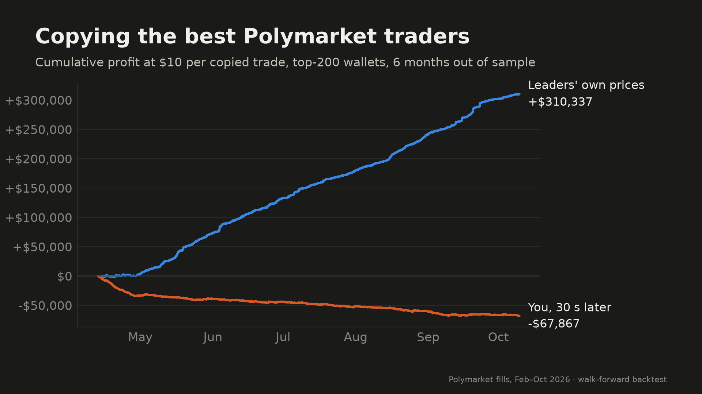

---

## 1. The question

> "If I find the traders who have been winning on Polymarket and copy every bet they make,
> will I make money?"

We turned that into three hypotheses, fixed **before** looking at any result:

| # | Hypothesis | What it would mean |
|---|---|---|
| H1 | Copying the top wallets has a return above 0 | Copy trading is profitable |
| H2 | Top wallets beat randomly chosen wallets | Picking "winners" adds value over picking anyone |
| H3 | Top wallets beat the worst wallets | The ranking separates skill from no skill at all |

## 2. How the experiment works

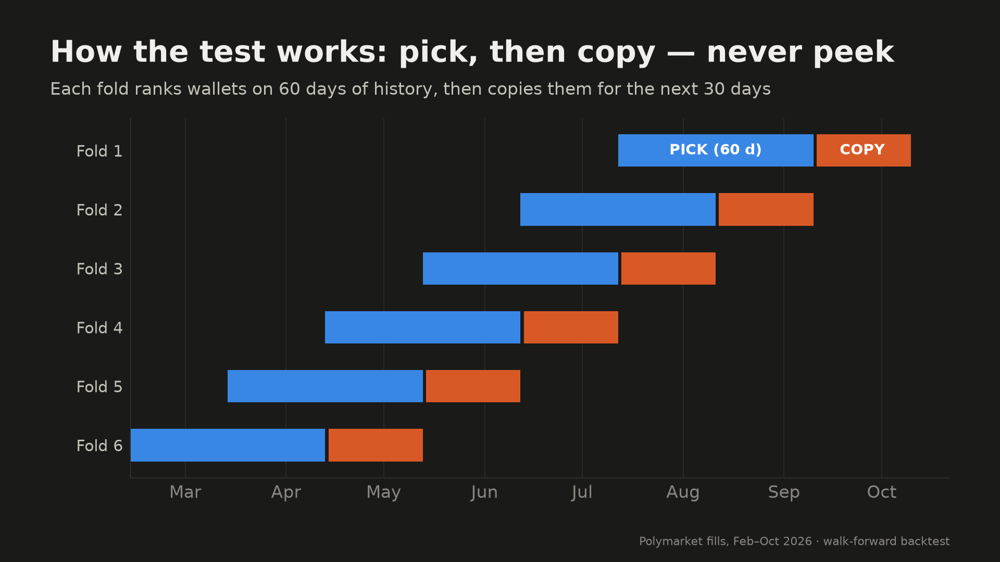

1. **Pick** — rank every active wallet on 60 days of history (≥100 fills, ≥20 markets).
   Score = how reliably the wallet beats the market price (a t-statistic of its edge per share),
   so one lucky bet can't put a wallet at the top. Only markets that had already resolved count.
2. **Copy** — for the next 30 days, copy every BUY those wallets make. You never see the future:
   the ranking is frozen before the copy window starts.
3. **Repeat** six times (walk-forward), giving six independent months: 13 Apr – 10 Oct 2026.
4. **Compare three groups** of 200 wallets each: **top**, **random**, **bottom**.

| Scale | |
|---|---|
| Wallets ranked | 3,003 (per fold, after activity filter) |
| Leader trades replayed | 12.6 M signals |
| Markets | 331 k |
| Copied trades (top group, primary setting) | 158,826 |

### Assumptions that make it realistic

| Assumption | How it is modelled |
|---|---|
| You are late | Delays of 0 s, 1 s, 10 s, 30 s, 60 s, 5 min. **0 s = the leader's own price, an impossible upper bound.** |
| You pay the real market price | You get the **next real trade** on the same outcome after your delay, not the leader's price. No trade within 1 h → you missed it. |
| Trading costs | Real fees per fill, plus extra slippage of 0 / 0.5 / 1 / 2 ¢ per share. |
| Exits | *Mirror*: when the leader sells, you sell at the next real bid. *Hold*: keep to resolution. |
| Payouts | Real resolution payouts incl. split markets; unresolved positions marked at last price. |
| Sizing | Same $ per copied trade. |
| Primary test (pre-registered) | **30 s late, +0.5¢ slippage, mirror exits.** |
| Statistics | Bootstrap clustered by market and fold, one-sided p-values, Holm correction for 3 tests. |
| Self-test | The whole pipeline was run on synthetic markets: 0% false positives with no skill, 80% detection with planted skill. |

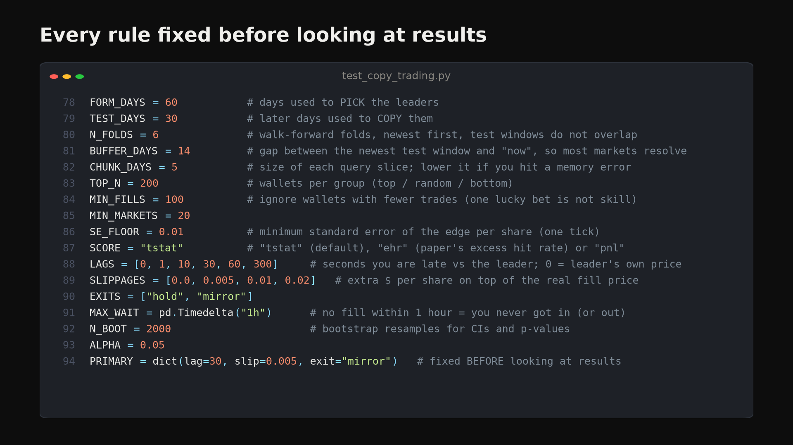

## 3. Results

### 3.1 The verdict

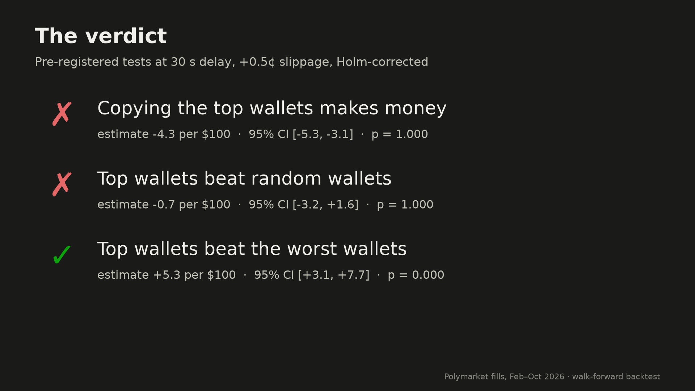

| Hypothesis | Estimate (per $100) | 95% CI | p (Holm) | Verdict |
|---|---:|---:|---:|---|
| H1: copying top wallets > 0 | **−4.27** | [−5.33, −3.15] | 1.00 | ✗ No |
| H2: top > random | −0.74 | [−3.23, +1.55] | 1.00 | ✗ No |
| H3: top > bottom | +5.32 | [+3.06, +7.68] | <0.001 | ✓ Yes |

### 3.2 Skill is real — you just can't get it

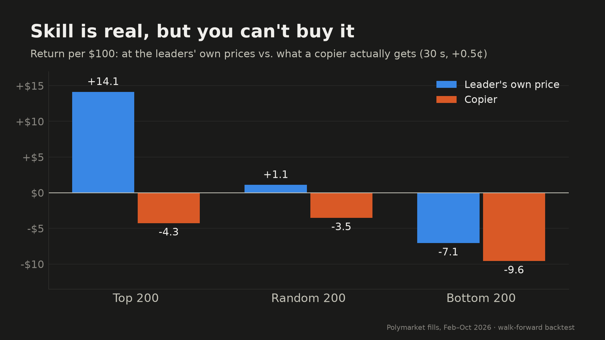

| Group | At leader's own price | Copier (30 s, +0.5¢) |
|---|---:|---:|
| Top 200 | **+14.1** | **−4.3** |
| Random 200 | +1.1 | −3.5 |
| Bottom 200 | −7.1 | −9.6 |

*Return per $100, mirror exits.*

### 3.3 The edge is gone within seconds

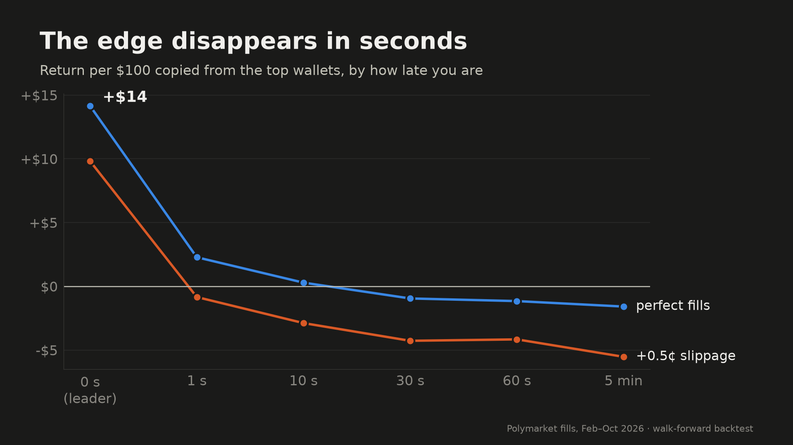

Return per $100 copying the **top** wallets (mirror exits):

| Delay | 0 s (leader) | 1 s | 10 s | 30 s | 60 s | 5 min |
|---|---:|---:|---:|---:|---:|---:|
| Perfect fills | +14.1 | +2.3 | +0.3 | −1.0 | −1.2 | −1.6 |
| +0.5¢ slippage | +9.8 | −0.8 | −2.9 | −4.3 | −4.2 | −5.5 |
| +1¢ slippage | +6.9 | −3.1 | −5.2 | −6.7 | −6.6 | −8.2 |
| +2¢ slippage | +2.1 | −6.9 | −9.2 | −10.8 | −10.9 | −12.6 |

Even a bot reacting in **1 second** with perfect fills keeps only +$2.3 of the +$14 — and
half a cent of slippage wipes that out. **Break-even slippage at 30 s: 0¢** (it's negative even
before slippage).

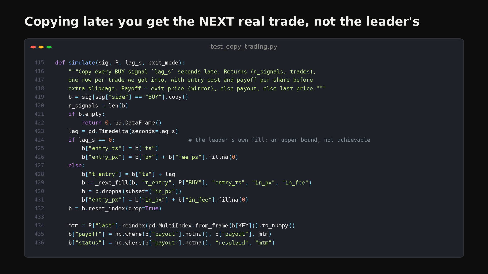

### 3.4 It's not one bad month

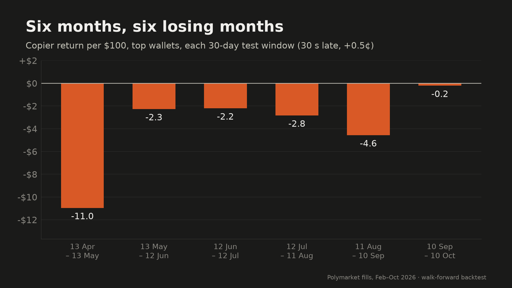

| Test window | Top | Random | Bottom | Top − Random |
|---|---:|---:|---:|---:|
| 13 Apr – 13 May | −11.0 | −19.5 | −24.0 | +8.5 |
| 13 May – 12 Jun | −2.3 | −6.0 | −9.0 | +3.7 |
| 12 Jun – 12 Jul | −2.2 | −3.4 | −3.6 | +1.2 |
| 12 Jul – 11 Aug | −2.8 | +2.9 | −13.7 | −5.8 |
| 11 Aug – 10 Sep | −4.6 | −4.8 | −6.3 | +0.3 |
| 10 Sep – 10 Oct | −0.2 | −5.0 | −15.7 | +4.8 |

Copying the top wallets lost money in **6 of 6** months. They beat random wallets in 5 of 6,
but not by enough to be distinguishable from noise once pooled.

### 3.5 Where the money is lost: speed

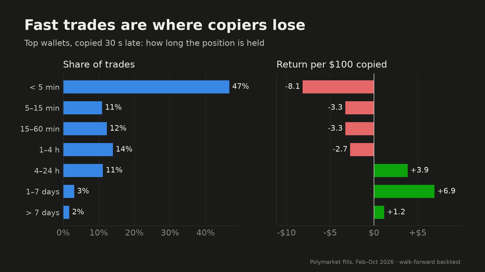

Top wallets copied 30 s late — median holding time **6.4 minutes** (mean 12.9 h; most trades are fast,
a few run for days).

| Held for | Share of trades | Return per $100 |
|---|---:|---:|
| < 5 min | 47% | −8.1 |
| 5–15 min | 11% | −3.3 |
| 15–60 min | 12% | −3.3 |
| 1–4 h | 14% | −2.7 |
| 4–24 h | 11% | +3.9 |
| 1–7 days | 3% | +6.9 |
| > 7 days | 2% | +1.2 |

Almost half the copied trades are in-and-out within 5 minutes — short-term crypto
up/down markets where the leader's edge is pure speed. Slower, longer positions were
profitable even for a late copier. *This is an after-the-fact observation, not a tested
strategy*: filtering by holding time uses information you don't have when you enter.

### 3.6 Robustness

| Check | Result |
|---|---|
| Drop the 5 biggest top wallets | −4.95 per $100 (worse, not driven by outliers) |
| Hold to resolution instead of mirroring sells (30 s, +0.5¢) | −1.95 per $100 [−3.42, −0.43] |
| Fill rate at 30 s (got a trade within 1 h) | 72% of signals |
| Position status | 50% resolved, 49% exited with leader, 0.7% marked to market |

### 3.7 How traders were ranked

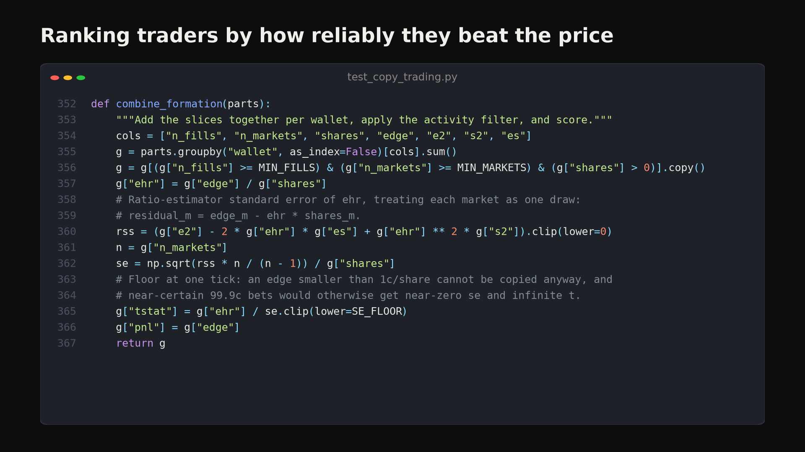
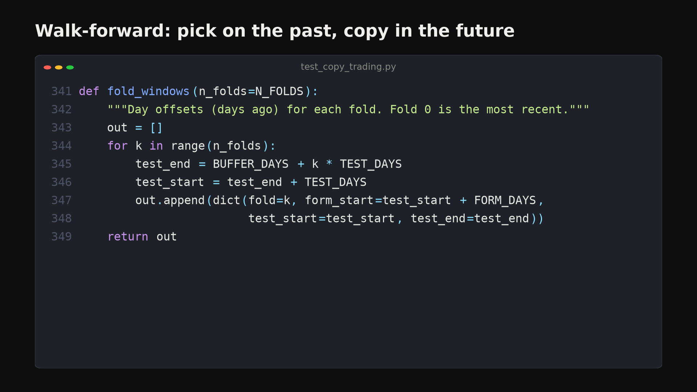
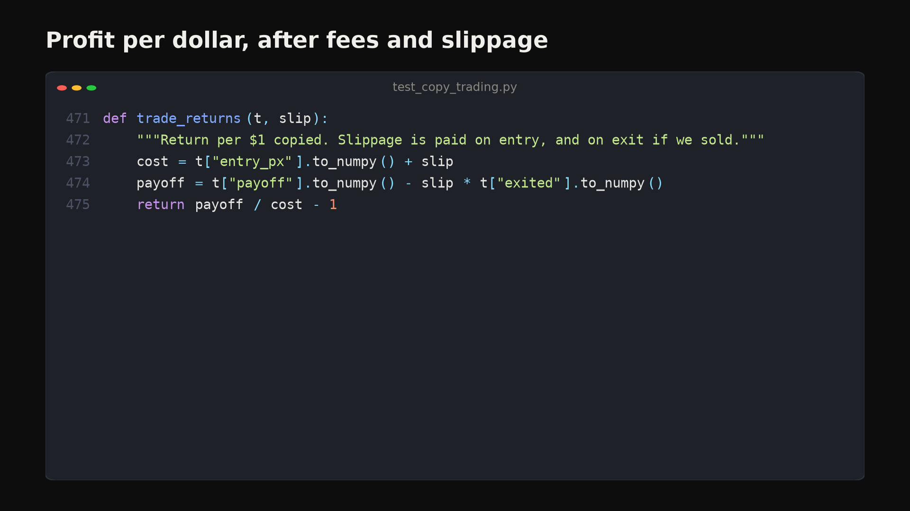

## 4. Caveats

- **Fees:** 98% of fills in the data show zero fee; if real costs are higher, copying is even worse.
- **Taker side only:** we can see who crossed the spread, not resting limit orders.
- **No market impact** beyond the slippage grid — at real size, copiers move prices against themselves.
- **Six months** of one venue in 2026; a different regime could look different.

## 5. Takeaway

The traders at the top of Polymarket are genuinely good — but their edge lives in the first
second after they trade. By the time a copier sees the trade and gets filled, the price has
already moved. **Copy trading here transfers money from the copier to the people who are faster.**

---

## 6. Video script (≈ 43 s, ~118 words at a brisk pace)

| Time | Voice-over | B-roll |
|---|---|---|
| 0:00–0:05 | "Can you get rich on Polymarket just by copying the best traders? I tested it on real data." | `charts/01_profit_curve.png` (blue line only, crop right) |
| 0:05–0:14 | "I ranked three thousand wallets on two months of history, then copied every bet the top two hundred made over the *next* month — six times, never peeking." | `charts/06_walk_forward.png` → `code/c2_walk_forward.png` |
| 0:14–0:20 | "Realistically, you're thirty seconds late, you pay the next real price, plus fees and a bit of slippage." | `code/c4_copy_entry.png` → `code/c1_settings.png` |
| 0:20–0:27 | "The traders are genuinely skilled: at their own prices they made fourteen dollars per hundred." | `charts/03_groups.png` (zoom on blue Top bar) |
| 0:27–0:35 | "But the copier? Minus four dollars per hundred, losing in all six months. The edge is gone after about one second." | `charts/01_profit_curve.png` (full) → `charts/02_delay_decay.png` → `charts/04_folds.png` |
| 0:35–0:43 | "Half the trades last under five minutes — it's a speed game. Copy trading just pays the faster player." | `charts/05_holding_time.png` → `charts/07_verdict.png` |
